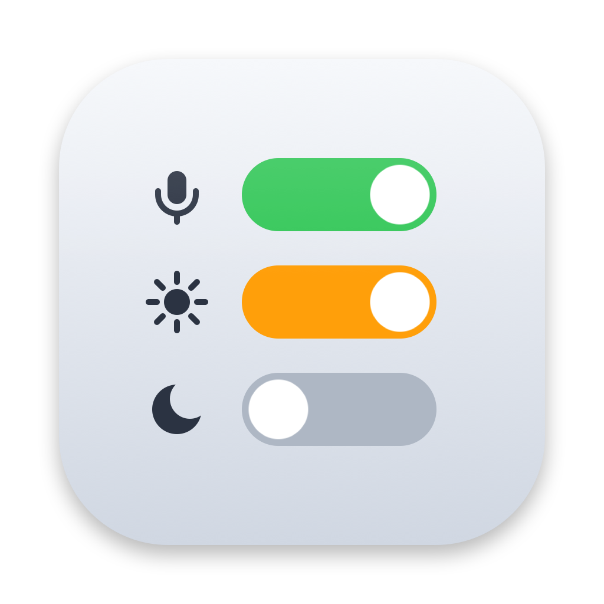

<div align="center">



# BarKit

**Small Mac tweaks, one menu bar icon.**

Pin your microphone, adjust volume and brightness, and keep your Mac awake, all from the menu bar.


</div>

---

## Features

| | Feature | What it does |
|---|---|---|
| 🎙️ | **Pin Input** | Keeps the microphone you picked as the system default, even when macOS switches it or the device reconnects |
| 🔊 | **Volume** | Separate sliders for microphone input level and output volume |
| ☀️ | **Brightness** | Controls the built-in display and DDC/CI external monitors independently |
| ☕ | **Keep Awake** | Prevents idle sleep for 30 min, 1, 2, 3 or 5 hours, or until you turn it off |
| 🔌 | **Awake on Power** | Turns Keep Awake on when the power adapter is connected and off when it is removed |
| 🚀 | **Launch at Login** | Starts with your Mac via `SMAppService` |

BarKit records no audio, never changes the default output device, and asks for no microphone, accessibility or screen-recording permission.

## Quick start

> **Requirements:** macOS 13 Ventura or newer and the Apple Command Line Tools (`xcode-select --install`). A full Xcode install is not needed.

```zsh
git clone https://github.com/gandriyko/barkit.git && cd barkit
./Scripts/install.sh
```

This builds BarKit, quits any running copy, installs it to `/Applications/BarKit.app` and launches it.

<details>
<summary><b>Install options</b></summary>

| Command | Result |
|---|---|
| `./Scripts/install.sh` | Build, install to `/Applications` and launch |
| `./Scripts/install.sh --no-launch` | Build and install without launching |
| `INSTALL_DIR=~/Applications ./Scripts/install.sh` | Install to another folder |
| `./Scripts/build.sh` | Build only, to `build/Release/BarKit.app` |

If you get a permission error writing to `/Applications`, run the install with `sudo` or use `INSTALL_DIR=~/Applications`.

</details>

## Usage

Click the BarKit icon in the menu bar. A badge appears on it while Keep Awake is on.

**Microphone**
- Choose a device under **Input Device**. Choosing one turns on **Pin Input** and saves the device.
- While **Pin Input** is on, BarKit switches back to your device whenever macOS changes the default input. A disconnected device is restored when it reconnects.
- Turn off **Pin Input** to let macOS choose the input again.

**Volume and brightness**
- **Microphone Volume** and **Output Volume** adjust the current system devices. Devices without an adjustable level show as unavailable.
- **Display Brightness** shows a slider for each display. DDC/CI support depends on the monitor, cable, adapter or dock.

**Keep Mac Awake**
- Choose a duration, or **Until Turned Off**.
- **Keep Display On** also stops the display from sleeping. Without it, only the Mac stays awake.
- **Turn On When Connected to Power** starts Keep Awake on the adapter and ends it on battery.
- A manually started session ends when BarKit quits and does not resume on relaunch.

**Launch at Login** works most reliably when BarKit runs from `/Applications`.

## Development

```
BarKit/            Swift sources, Info.plist, app icon
Scripts/
  build.sh         Compile a universal, ad-hoc signed app with swiftc
  install.sh       Build and install to /Applications
  make-icon.sh     Regenerate BarKit.icns from AppIcon.svg
```

The app is built directly with `swiftc`, without an Xcode project build, and uses only system frameworks: AppKit, CoreAudio, CoreGraphics, IOKit and ServiceManagement.

**App icon.** The source is `BarKit/AppIcon.svg`. After editing it, run `./Scripts/make-icon.sh` to regenerate `BarKit.icns` and `AppIcon-source.png`.

## Migrating from InputPin

On first launch BarKit copies the pin setting and saved device from the legacy `com.inputpin.app` preferences and leaves the old ones unchanged. If InputPin was a login item, disable it and turn on **Launch at Login** in BarKit so the two apps don't start together.
